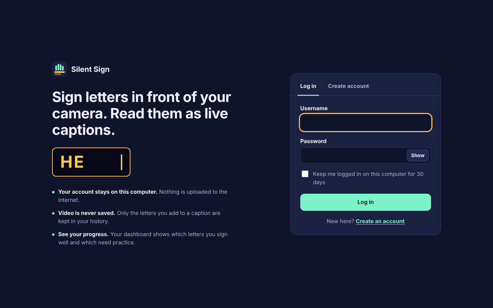
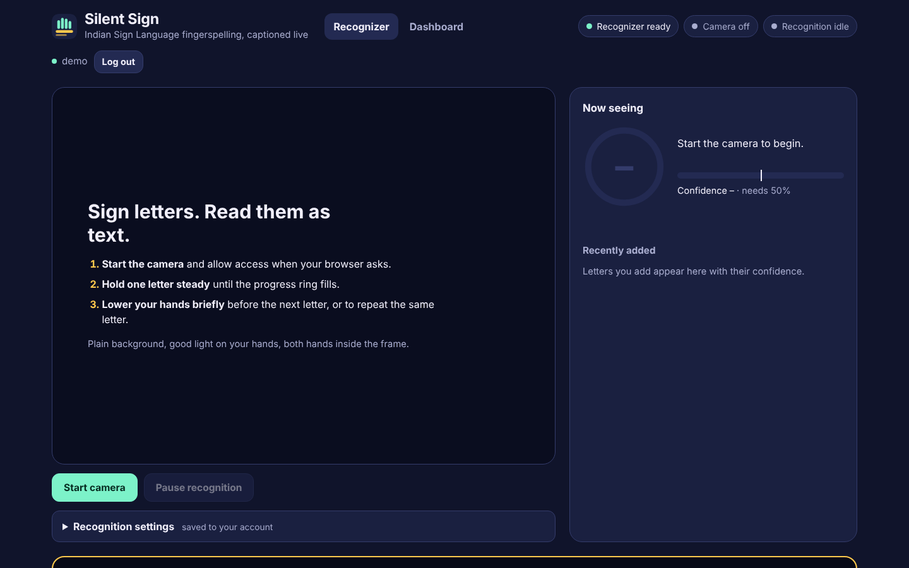
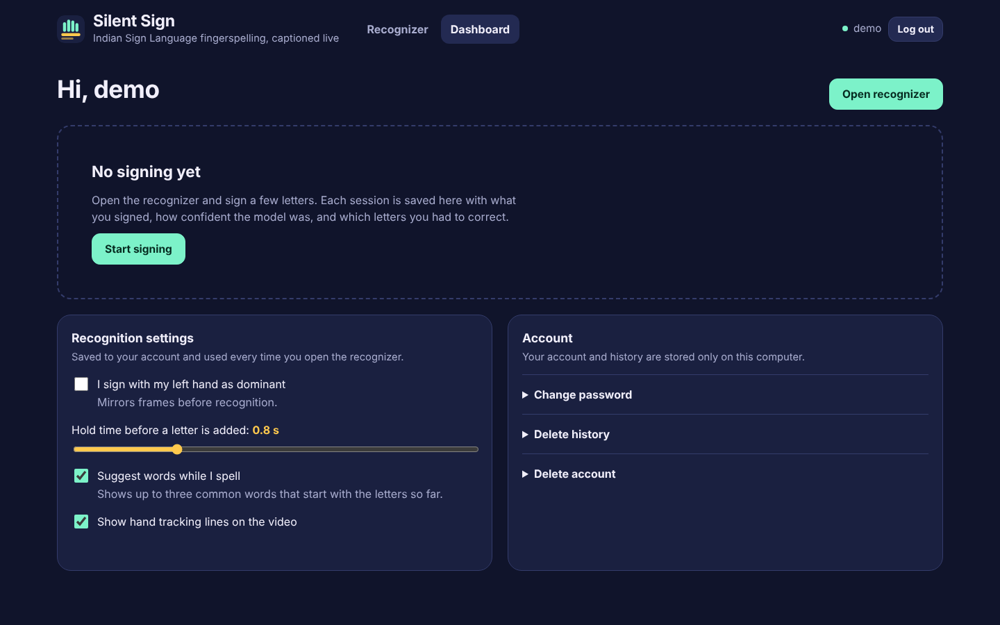

# Silent Sign — Indian Sign Language Fingerspelling to Text

Silent Sign is a local web app that recognizes **static Indian Sign Language (ISL) fingerspelling** from a webcam and turns the recognized letters into live text captions. A hearing person can read, copy, download or listen to the caption, and can type a reply that is shown back to the signer as ISL alphabet photos.

> **Scope:** Silent Sign recognizes 23 static ISL alphabet handshapes, one letter at a time. It is **not** a sign-language translator: it does not recognize word signs, signs that involve movement, or sentence grammar.

> 🎓 Academic team project. See [Team and acknowledgements](#team-and-acknowledgements).

---

## Problem statement

People who communicate in Indian Sign Language often have no quick way to be understood by people who don't sign, and interpreters are scarce. Fingerspelling (spelling words letter by letter) is a small, well-defined part of ISL that a camera-based system can attempt to recognize. This project explores how far a lightweight, fully local pipeline can go on that sub-problem, and measures its accuracy honestly.

## Objectives

- Recognize static ISL alphabet handshapes from an ordinary webcam in real time.
- Turn a stream of per-frame predictions into stable, readable captions.
- Keep all processing on the user's own machine (no cloud calls, no stored video).
- Evaluate the model with a train/test split that avoids leakage between near-duplicate images.
- Give users a history of their signing so they can see which letters are recognized reliably for them.

## Features

**Recognition**
- Webcam frames (~8 per second) are sent to a local Flask server, which runs **MediaPipe Hands** (up to two hands, 21 landmarks each).
- Landmarks are converted into a 213-value, position- and scale-normalized feature vector (`backend/features.py`), shared by training and inference.
- An **ExtraTrees** classifier (scikit-learn) predicts one of 23 letters with a confidence score; predictions below the stored threshold (0.50) are not accepted.
- A frontend **stabilizer** (`js/stabilizer.js`) only adds a letter when it dominates the recent frames, and prevents the same held sign from being added twice.
- Left-handed mode (mirrors frames before recognition) and an adjustable hold time.

**Captions and communication**
- Live caption with add space, delete last, clear/undo, copy, read aloud (browser speech synthesis) and `.txt` download.
- Word suggestions from an offline list of ~8,000 common English words; press `1`–`3` to complete a word.
- "Show letters to the signer": the hearing person types a reply and it is displayed as ISL alphabet reference photos.
- Keyboard shortcuts: `P` pause, `S` space, `Backspace` delete, `C` copy, `1`–`3` pick a suggestion.

**Accounts and dashboard (local only)**
- Sign up / log in; passwords hashed with Werkzeug (scrypt); 5 failed logins lock the username for 60 s.
- Per-user settings, session history with transcripts, letters-per-day chart, per-letter kept vs. corrected counts and "letters that need practice".
- Delete individual sessions, all history, or the account.

**Security measures in the local server**
- Every state-changing API request must carry a custom `X-Silent-Sign: 1` header (CSRF protection).
- `HttpOnly`, `SameSite=Strict` session cookie signed with a random per-install key.
- Upload size/type validation, security headers, and the server binds to `127.0.0.1` only.

## Technologies used

| Area | Technology |
|---|---|
| Hand tracking | MediaPipe Hands 0.10.21 |
| Model | scikit-learn 1.5.2 (`ExtraTreesClassifier`), joblib |
| Image handling | OpenCV (`opencv-contrib-python`), NumPy |
| Backend | Python 3.11/3.12, Flask 3.1, Werkzeug |
| Storage | SQLite (accounts, settings, session history) |
| Frontend | HTML, CSS, vanilla JavaScript (`getUserMedia`, Canvas, Web Speech API) |
| Training / reports | scikit-learn, Matplotlib |
| Tests | Python `unittest` (backend), Node.js scripts (frontend logic) |
| Earlier experiment | TensorFlow/Keras MobileNetV2 CNN (not used by the app; see below) |

## System architecture

```
Browser (index.html, js/app.js)                  Local server (backend/app.py, Flask)
  webcam ── ~8 JPEG frames/s ── POST /api/predict ──► MediaPipe Hands: ≤2 hands × 21 landmarks
                                                       features.py: normalize → 213 features
                                                       ExtraTrees → letter + confidence
  stabilizer.js ◄── label, confidence, top-3, ─────────┘
  (hold to add, release to repeat)   landmarks for the overlay
  caption · suggestions · history-log.js ──► /api/sessions (SQLite, instance/silent_sign.db)
```

**Workflow**
1. The browser captures a frame and skips sending if the previous request is still in flight.
2. MediaPipe detects hands; if none are found, no letter is produced.
3. `features.py` normalizes the landmarks so position and hand size don't matter.
4. The classifier returns probabilities for 23 letters; the top prediction is accepted only above the threshold.
5. The stabilizer adds the letter once it has dominated the hold window (≥70% agreement), then locks it until the hands drop or a new letter appears.
6. Caption events (add, delete, space, suggestion) are saved to the user's session history.

### Main API endpoints (all on `127.0.0.1`)

| Endpoint | Purpose |
|---|---|
| `GET /api/health` | Model status, classes, threshold and recorded test metrics |
| `POST /api/predict` | One JPEG/PNG frame in; hands detected, landmarks, prediction, top-3, accepted flag out |
| `POST /api/reset` | Reset hand-tracking state |
| `POST /api/auth/signup` · `login` · `logout` | Accounts |
| `GET`/`PUT /api/settings` | Per-user recognition settings |
| `POST /api/sessions`, `POST /api/sessions/<id>/events` | Session history |
| `GET /api/sessions/<id>/transcript`, `GET /api/stats` | Transcripts and dashboard statistics |

## Model and evaluation

The live model is `model/isl_landmark_model.joblib` (metadata in `model/model_meta.json`), produced by `training/train_landmark_model.py`. The figures below are the ones **recorded by that script** in `model_meta.json`; re-running the script reproduces them exactly.

| | |
|---|---|
| Images read | 702 images, 23 classes (A–Z without H, J, Y) |
| Excluded | 16 images (8 identical pictures filed under both `O/` and `Q/`) |
| No hand detected by MediaPipe | 168 images |
| Usable | 518 images in 378 near-duplicate groups |
| Held-out test set | 114 images (grouped split: no near-duplicate crosses train/test) |
| Test accuracy (all predictions) | 71.9% |
| At the 0.50 confidence threshold | Answers 70.2% of test images; 85.0% of those are correct |
| Cross-validation accuracy (training split) | 78.7% |

**Why the grouped split matters:** many dataset images are the same hand cut-out pasted on different backgrounds. A random split puts copies in both train and test and inflates the score, so near-duplicates are grouped before splitting.

**Weak letters:** O, B and Q scored 0% on very small test samples, and X was correct 1 of 3 times. Per-letter results are in `training/output/landmark_report.txt` and `training/output/landmark_confusion_matrix.png`.

These numbers come from dataset photos, not live use. Accuracy on a real webcam depends on the signer, lighting and camera angle, and the dataset contains only a handful of signers.

**Earlier approach:** a MobileNetV2 CNN (`training/train_isl_model.py`) was tried first. It overfit heavily (the project's own re-measurement recorded 42.6% validation vs. 88.6% training accuracy) and is not used by the app. Its trained files (~71 MB) are not stored in this repository; they are attached to the GitHub Release instead.

## Project structure

```
silent-sign/
├── index.html, login.html, dashboard.html   Pages (served by the Flask app)
├── css/                                      Styles
├── js/
│   ├── app.js            Camera, server calls, caption, suggestions, export
│   ├── api.js            JSON helper (adds the CSRF header, handles logout)
│   ├── stabilizer.js     Hold-to-add / release-to-repeat logic
│   ├── suggest.js, words.js   Word suggestions + offline word list
│   ├── history-log.js    Saves caption activity in the background
│   ├── reference.js      "Show letters to the signer"
│   └── login.js, dashboard.js
├── backend/
│   ├── app.py            Flask server: pages, recognition API, security checks
│   ├── accounts.py       Accounts, settings, history, statistics, transcripts
│   ├── db.py             SQLite + secret key (created in instance/)
│   ├── inference.py      Loads the model; MediaPipe + classifier
│   └── features.py       Landmarks → feature vector (shared with training)
├── model/                Trained landmark model + metadata
├── training/
│   ├── train_landmark_model.py   Dataset audit, training, evaluation
│   ├── train_isl_model.py        Earlier CNN experiment (not used by the app)
│   ├── check_dataset.py
│   └── output/                   Reports, confusion matrices, landmark cache
├── ISL_Dataset/          Training images (third-party dataset, see licensing)
├── assets/letters/       One reference photo per letter (from ISL_Dataset) + sources.json
├── tests/                Python and Node.js tests
├── legacy/meeting-demo/  Earlier UI prototype, kept for reference
├── docs/screenshots/
├── .vscode/              Windows run/debug tasks
└── requirements.txt
```

## Installation

**Requirements:** Python **3.11 or 3.12** (MediaPipe 0.10.21 has no Python 3.13 build), a webcam, and Chrome or Edge. Node.js is optional (only for the frontend tests).

### Windows (PowerShell)

```powershell
git clone https://github.com/<your-username>/silent-sign.git
cd silent-sign
py -3.12 -m venv .venv
.\.venv\Scripts\python.exe -m pip install --upgrade pip
.\.venv\Scripts\python.exe -m pip install -r requirements.txt
```

### macOS / Linux

```bash
git clone https://github.com/<your-username>/silent-sign.git
cd silent-sign
python3.12 -m venv .venv
source .venv/bin/activate
pip install --upgrade pip
pip install -r requirements.txt
```

The install downloads roughly 350 MB of packages.

## How to run

```powershell
# Windows
.\.venv\Scripts\python.exe backend\app.py
# macOS / Linux
python backend/app.py
```

1. Open **http://127.0.0.1:5000** in Chrome or Edge (use this address; don't open `index.html` directly).
2. Create an account, then log in.
3. Select **Start camera** and allow camera access.
4. Hold a letter steady until the progress ring fills. Lower your hands briefly before repeating a letter.

Use `--port 5050` if port 5000 is busy. Signing tips, a manual webcam test checklist and a troubleshooting table are in [docs/USAGE_AND_TROUBLESHOOTING.md](docs/USAGE_AND_TROUBLESHOOTING.md). In VS Code you can also use **Terminal → Run Task → Silent Sign: start server**.

On first run the server creates an `instance/` folder holding the local SQLite database and the cookie-signing key. It is git-ignored and should never be shared. To reset all accounts, stop the server and delete `instance/`.

### Run the tests

```bash
python -m unittest discover -s tests -v   # 35 backend tests
node tests/stabilizer.test.js             # 9 stabilizer tests
node tests/suggest.test.js                # 7 suggestion tests
```

### Retrain the model (optional)

```bash
python training/train_landmark_model.py
```

Takes about a minute on a laptop CPU and overwrites `model/isl_landmark_model.joblib` and `model/model_meta.json`.

## Screenshots

| Log in | Recognizer (camera off) |
|---|---|
|  |  |

| Dashboard (new account) | Live recognition |
|---|---|
|  | _Add a screenshot or GIF of live signing here_ |

## Current limitations

- **Letters only:** 23 static handshapes. H, J and Y are not in the dataset and can never be recognized.
- **No motion or words:** each frame is classified on its own; signs defined by movement, word signs and grammar are out of scope. Spaces are added by the user.
- **Small, narrow dataset:** ~700 images from about 4–5 signers, many composited onto backgrounds, plus some label noise (O/Q). Expect lower accuracy for other signers, skin tones, lighting and camera angles.
- **Hand detection failures:** MediaPipe found no hand in 24% of dataset images.
- **Local use only:** accounts protect history on a shared PC; the built-in Flask server has no HTTPS and is not meant for internet deployment.
- The reference photos show how the dataset signs each letter; they are not an official ISL dictionary.

## Future improvements

- Collect data from more signers (varied skin tones, lighting, cameras) and evaluate with a signer-grouped split.
- Add the missing letters (H, J, Y) and digits; J and Y need motion-aware recognition.
- Extend to **word-level and dynamic signs**: store sequences of landmark features from video clips (e.g. the INCLUDE ISL dataset) and train a GRU/LSTM or small temporal transformer, served by a rolling-window endpoint.
- Add pose and face landmarks for signs that use them.
- Package as a production deployment (HTTPS, a proper WSGI server) if it is ever to run beyond one machine.

## Team and acknowledgements

This was developed as an academic team project at Mukesh Patel School of Technology Management & Engineering (MPSTME), NMIMS.

- **Team:** _[add team member names / GitHub links]_
- **My contributions:** _[describe your own part, e.g. data audit, training pipeline, frontend, accounts/dashboard, testing]_

**Third-party data and libraries**
- Training images (`ISL_Dataset/`): the project's original notes name the Kaggle dataset *Indian Sign Language (ISL)* by prathumarikeri as the source. **This is not yet confirmed.** Published descriptions of that dataset (about 42,000 images, 35 classes including digits, light backgrounds) don't match this folder (702 images, 23 letter classes, many composited or video-frame images). _[Confirm the exact source, link and license before publishing; see note below.]_
- Hand tracking: [MediaPipe](https://github.com/google-ai-edge/mediapipe) (Apache-2.0).
- Word-suggestion list derived from [wordfreq](https://github.com/rspeer/wordfreq) by Robyn Speer. wordfreq's code is Apache-2.0/MIT, but its **word-frequency data is licensed CC BY-SA 4.0**, so the derived list in `js/words.js` carries that attribution requirement.

> ⚠️ **Before publishing:** confirm where `ISL_Dataset/` came from and that its license allows redistribution. Some images show identifiable people, including faces. If redistribution isn't clearly allowed, remove `ISL_Dataset/` and `assets/letters/` from the repository and link to the source instead (the backend tests and the "show letters" panel use these images, so note that they must be downloaded separately).

## License

_[Choose a license for the code with your team (e.g. MIT) and add a `LICENSE` file. The dataset and word list keep their own licenses.]_
